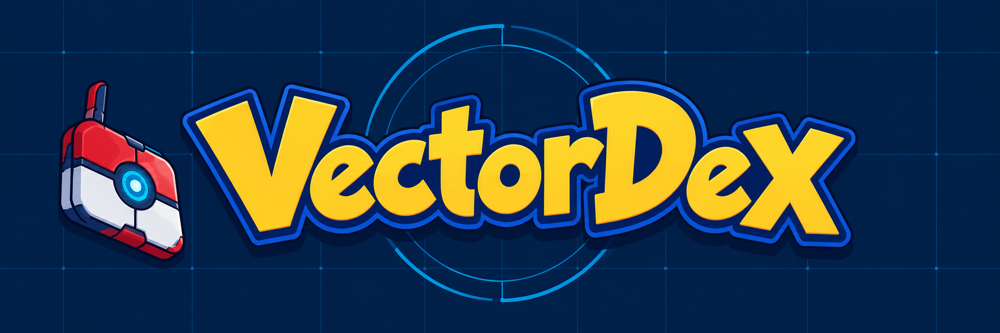
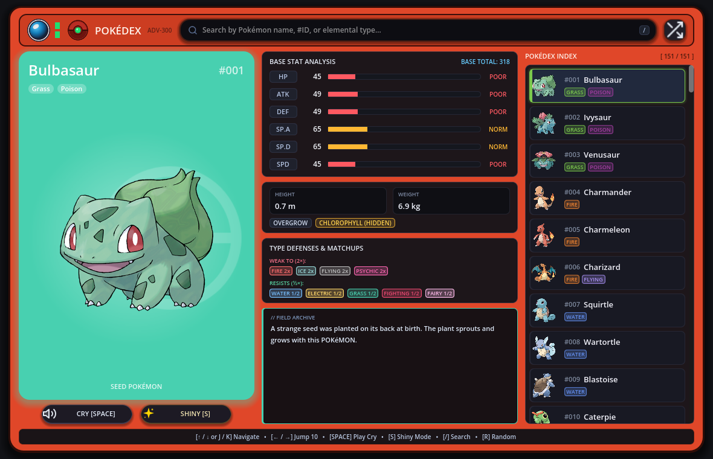
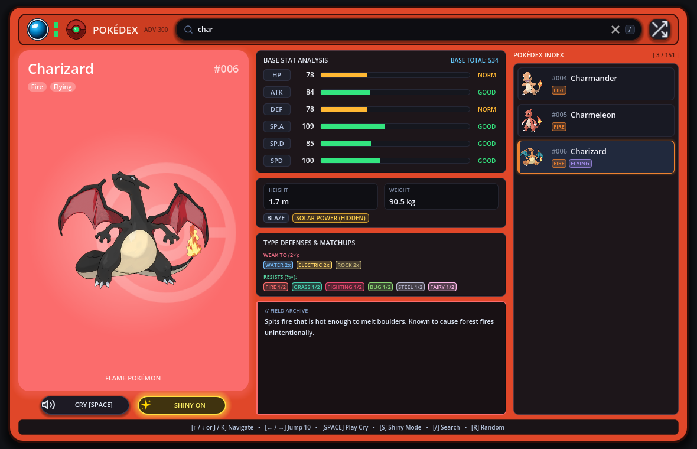

[](assets/images/vectordex-banner-v2.png)

# VectorDex

i wanted a Pokédex that felt like a little console i could actually poke around in. so i made VectorDex: a desktop Pokédex built with Godot and GDScript, with Ruby doing the work of collecting the data. rn it covers the original 151 Pokémon, and i just wanted an excuse to learn ruby tbh.

pick someone from the index and the whole screen changes with them. u get their artwork, types, stats, abilities, height, weight, and a Pokédex description. i added their cries (lol), shiny art, and type defenses too, cuz those are the bits i always end up lookin for.

## What it looks like

here's the main screen with Bulbasaur pulled up:

[](docs/screenshots/overview.png)

and here's shiny Charizard after searching for `char`:

[](docs/screenshots/shiny-search.png)

## Wanna try it?

you'll need Godot 4.7. the Pokédex data, artwork, shiny images, and cries are already in the repo, so you don't need to run the ruby script just to open the app.

```bash
git clone https://github.com/shadysbasement/pokedex.git
cd pokedex
godot --path .
```

you can also open `project.godot` in the godot editor and press **F5**.

## Finding your way around

click a pokémon in the index to pull up its entry. the search box accepts a name, Pokédex number, or type. the main card changes color with the Pokémon's primary type, and the other panels show its base stats, abilities, description, and what it's weak to or resists.

if you wanna use the keyboard:

| Key | What it does |
| --- | --- |
| `/` | Focus search |
| `Esc` | Clear search and leave the search box |
| `↑` / `↓` or `K` / `J` | Previous / next Pokémon |
| `←` / `→` | Jump back / forward 10 entries |
| `Space` | Play the current Pokémon's cry |
| `S` | Toggle shiny artwork |
| `R` | Pick a random Pokémon |

there are buttons for the cry, shiny mode, and random pick too. selecting a Pokémon also plays its cry, so you don't have to press **Space** every time.

## Where the data comes from

the ruby script in `tools/fetch_pokedex.rb` pulls Pokémon details from PokéAPI, cleans up the flavor text, downloads the regular artwork and cries, then writes `data/pokedex.json` for godot to read. it defaults to 151 entries and uses eight worker threads.

If you wanna rebuild that data, you'll need ruby and an internet connection:

```bash
ruby tools/fetch_pokedex.rb
```

the shiny images are bundled separately in `assets/images/shiny/`, that script doesn't download them.

## Run the checks

from the project folder:

```bash
godot --headless --path . --script res://tests/test_pokedex.gd
```

the checks load the scene and data, then try selection, shiny mode, search, keyboard navigation, and the random picker. i ran them with godot 4.7.2 and all eight passed.

## If you're looking through the code

`scripts/main.gd` handles the screen, search, selection, and controls. `scripts/type_chart.gd` works out type defenses, and `scripts/sound_manager.gd` handles cries and the little UI sounds. the layout is in `scenes/main.tscn`, while `tools/fetch_pokedex.rb` builds the data the app reads.

the type panel currently groups matchups into weaknesses and resistances. it doesn't show the exact multiplier for every dual-type matchup yet.

## Credits

Pokémon data comes from [PokéAPI](https://pokeapi.co/). Pokémon names, artwork, and cries belong to their respective owners; VectorDex is a fan project. (also dont ask me why i named it vectordex cuz idk either)
